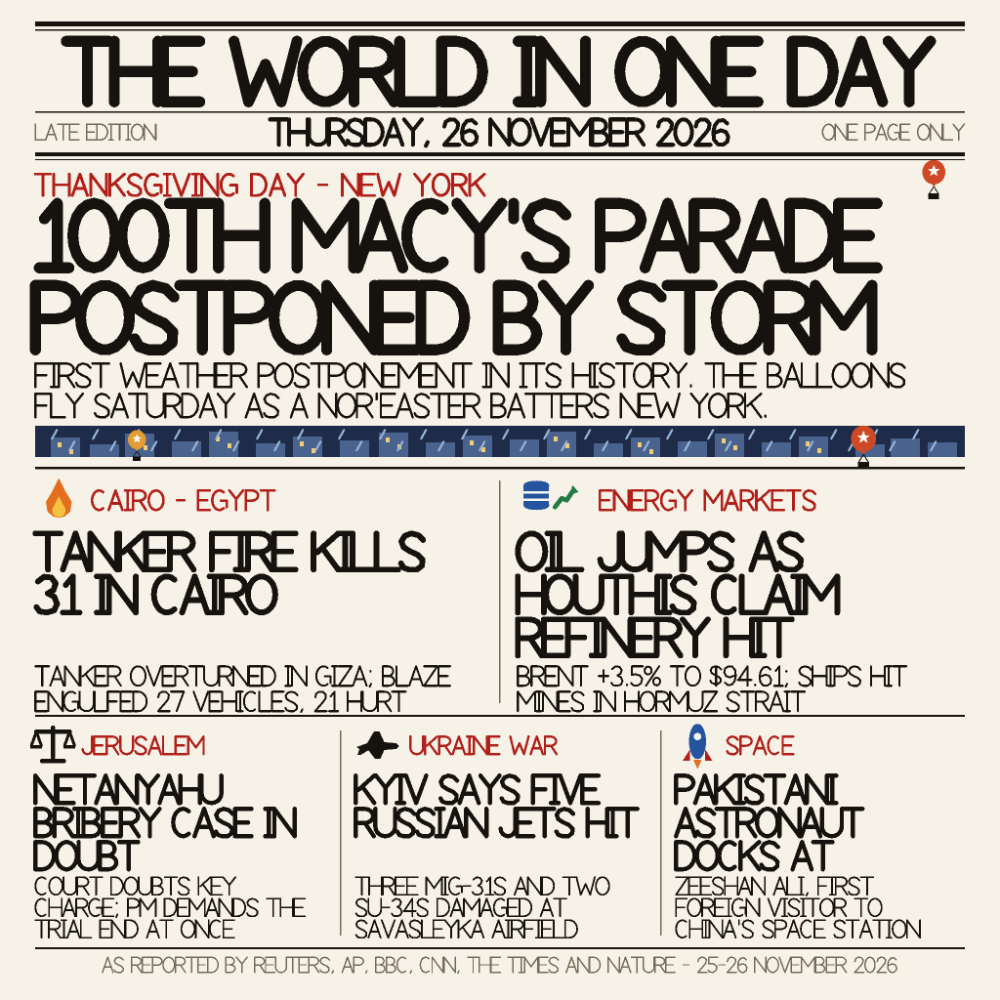

# The World in One Day — Thursday, 26 November 2026

[](https://make.fun/bounty/news-image-20261126?utm_source=github&utm_medium=readme&utm_campaign=news-image-20261126)
[](https://make.fun/bounty/news-image-20261126/leaderboard?utm_source=github&utm_medium=readme&utm_campaign=news-image-20261126)
[](https://make.fun/bounty/news-image-20261126?utm_source=github&utm_medium=readme&utm_campaign=news-image-20261126)

An entry for make.fun's [“Sum up 26 November's world news in one image”](https://make.fun/bounty/news-image-20261126) bounty ($100, top 50 paid). The program draws a complete newspaper front page — masthead, date line, six stories with headlines, standfirsts and small iconic illustrations — entirely in code, and writes it as one 1024×1024 PNG.



## How it works

`main.ts` (Node 22, standard library only, no dependencies) contains everything:

- **A tiny software rasteriser** — a supersampled pixel canvas with filled shapes, ellipses, polygons and thick round-capped strokes, box-downsampled for anti-aliased edges.
- **A hand-built stroke typeface** — every capital letter, digit and punctuation mark is defined as polylines on a 10-unit grid and stroked at any size or weight, so headlines, kickers and standfirsts are all drawn by the program itself. No font files, no image assets.
- **A minimal PNG encoder** — CRC32, per-row filter selection and zlib compression, written from scratch.
- **The page** — palette, layout, and little drawn pictures for each story: the parade balloon over a rainy skyline, a flame, an oil barrel with a rising arrow, scales of justice, a jet and a rocket.

The output is fully deterministic: no clock, no randomness, no network. Two runs write byte-identical files (SHA-256 `e94913e755f122e2af3a476a827d7f7f5750a5390a8dec9e7c24d83355789dd8`, 90,246 bytes).

## Run it

```sh
mkdir -p out && MAKEFUN_OUTPUT_DIR=out node main.ts
# writes out/entry.png — in the grader's container it writes /output/entry.png
```

## The day's stories, and where they were reported

Every story on the page was reported on 25–26 November 2026 and verified against at least two independent outlets before it was drawn:

1. **100th Macy's Thanksgiving Day Parade postponed by storm** — moved to Saturday 28 November, the first weather postponement in its history, as a nor'easter brought high-wind and coastal-flood warnings to New York.
   - Reuters — “Macy's Thanksgiving Day Parade in New York City postponed due to storm projections”
   - CNN — “100th Macy's Thanksgiving Day Parade moved to Saturday due to projected storm”
   - Associated Press — “Macy's Thanksgiving Day Parade postponed to Saturday due to weather”
2. **Cairo fuel tanker fire kills 31** — a petroleum tanker overturned on the Ring Road in Giza's Warraq district; the blaze engulfed 27 vehicles and injured 21 (Egyptian Health Ministry figures).
   - CNN — “At least 31 killed in fuel tanker fire near Cairo, Egyptian authorities say”
   - Associated Press — “Egypt fuel tanker crash ignites highway fire that kills at least 31, authorities say”
   - The Times — “Egypt fire: 31 dead in Cairo as fuel tanker bursts into flames”
3. **Oil jumps as Houthis claim a strike on Saudi Arabia's Ras Tanura refinery** — Brent rose 3.5% to $94.61; Saudi Arabia said it downed four drones over the site, and ships struck Iranian mines in the Strait of Hormuz.
   - Reuters — “Oil rises on supply concerns as Iran claims mine strikes on ships”
   - OilPrice — “Oil Jumps Over 2% as Saudi Arabia Downs Drones Over Ras Tanura”
4. **Netanyahu bribery case in doubt** — Jerusalem District Court judges recommended prosecutors drop the Case 4000 bribery case and reconsider Case 2000; Netanyahu demanded the trial end at once.
   - Reuters — “Israeli judges recommend prosecutors drop one bribery case against Netanyahu”
   - CNN — “Netanyahu gets major legal boost as court casts doubt on corruption case”
5. **Ukraine says five Russian jets hit at Savasleyka** — three MiG-31s and two Su-34s damaged in a deep strike on the airfield east of Moscow, per Ukraine's General Staff.
   - BBC News — “Five Russian military jets hit in airfield strike, says Ukraine”
   - The Kyiv Independent — “Ukrainian Forces Strike Five Russian Aircraft at Savasleyka Airfield”
6. **Pakistan's first astronaut docks at China's Tiangong station** — payload specialist Muhammad Zeeshan Ali arrived aboard Shenzhou-24, the first foreign visitor to Tiangong.
   - Nature — “Pakistani astronaut to become first foreign visitor to China's space station”
   - The News International — “China's Shenzhou-24 carrying Pakistani astronaut docks at space station”

## License

MIT — see [LICENSE](LICENSE).
